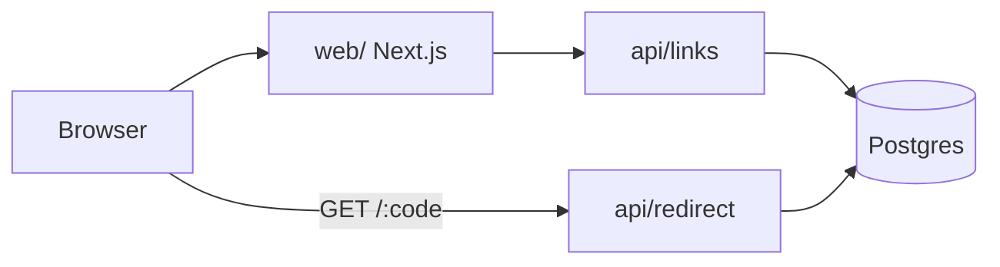

# Shortly — How it works
> Short links with click counts · Updated 2026-10-27

## What it is
Paste a long URL, get a short one, see how many times it was clicked. For people sharing links in chats and slides. No accounts in v1.

## The picture

## How it works
1. **Create a link:** `Code`
   `POST /api/links` validates the URL, makes a 7-char code, and stores it.
   Verify: `npm test -- links.test.ts`
2. **Redirect:** `Code`
   `GET /:code` looks up the code, adds 1 to the click count, and returns 302. Unknown codes return 404.
   Verify: `curl -I localhost:3000/abc1234`
3. **Abuse check:** `Human`
   Links reported via the "Report" button land in a review queue.
   Verify: `/admin/reports`

## Decisions
| Decision | Why | Rejected |
|---|---|---|
| Postgres (Neon) | free tier, SQL counts are simple | Redis (no durable analytics) |
| 7-char base62 codes | 3.5T combinations, still typeable | UUIDs (too long) |

## Not doing
- Accounts, custom domains, or per-country analytics in v1.

## Run it
`npm i` · `cp .env.example .env` · `npm run dev` · `npm test`

## Glossary
- **Code:** the 7-character id in a short link (`/abc1234`).
- **Report queue:** links people flagged, waiting for a human decision.

## Open questions
| Question | Proposed default |
|---|---|
| Link expiry? | Never expire in v1 |
